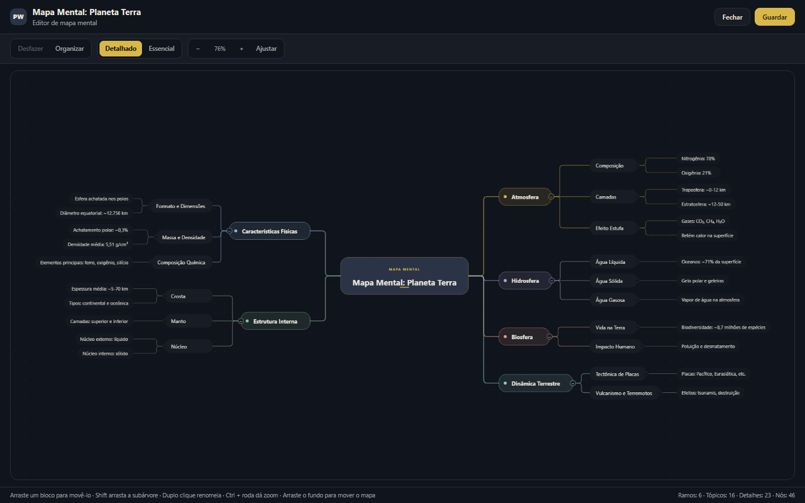

# PenWeb

**Highlight, draw and annotate on any web page.**

PenWeb is a free Chrome extension (Manifest V3) that turns any page — video lectures, in-browser PDFs, handouts, articles — into a study whiteboard. Everything is processed and stored **locally in your browser**: no personal data is collected or transmitted.

🔗 [Chrome Web Store](https://chromewebstore.google.com/detail/penweb/mmbhcihaimenkcagobpnkopbhdcgpopd) ·
🌐 [Website](https://thallyz.github.io/penweb/en/) ·
🇧🇷 [Site em português](https://thallyz.github.io/penweb/)



---

## What's new in v1.6

### 🗺️ Mind map editor in a tab
Open any generated map in a full editor tab: drag nodes, hold Shift to move a subtree, rename blocks, undo and use Ctrl + wheel to zoom toward the pointer. Positions are saved and the map exports as PNG.

### ✦ Floating launcher
A draggable ✦ button stays visible on any page, remembers its position and opens or closes the side panel with one click.

### 🖥️ Context menu actions
Right-click any page for highlight, explain, summarize, translate, turn on the pen, open the panel and generate a page summary.

### 🔍 Side panel zoom
Zoom the side panel from 80% to 125% without affecting the page, and vice versa.

### 〰️ Real-time stroke smoothing
Toggle smoothing on the main toolbar and get a clean, steady line while you draw — no more jittery strokes on touchpads or touchscreens.

### 🧮 Readable math & code
AI responses now render real fractions, code blocks and equations. Every response has a one-click copy button.

### 📸 Region capture + AI vision
Select an area of the page (or paste a screenshot with Ctrl+V) and ask the AI to analyse only that region. Powered by Groq's vision models.

---

## Features

- **Pressure-sensitive pen** — adjustable thickness, colour and opacity with smoothed strokes.
- **Highlighter** — mark passages without changing the original page DOM.
- **Editable mind maps** — generate a map from your highlights, edit it in a tab and export it as PNG.
- **Real screen capture** — export your annotations together with the visible page content as PNG.
- **Smart autosave** — reload the page by accident? PenWeb offers to restore your drawing.
- **Trilingual interface** — English, Portuguese and Spanish, auto-detected from your browser language.
- **Accessible** — high-contrast mode, adjustable UI scale and `prefers-reduced-motion` support.

## Privacy first

PenWeb **collects no personal data**. Your drawings are saved only in your browser's local storage. Nothing is sent to any server. [Read the full policy](https://thallyz.github.io/penweb/en/privacy.html).

## Roadmap

- [x] Chrome (Manifest V3) — available on the Chrome Web Store
- [ ] Edge Add-ons
- [ ] Firefox
- [ ] Safari
- [x] PenWeb AI with your own key (OpenRouter, Google Gemini or Groq)
- [ ] PenWeb AI hosted line — explain highlights, generate mind maps and flashcards without a key

## About this repository

This repo contains the **official website** (static HTML + CSS, hosted on GitHub Pages) and the small remote config read by the extension.

```
penweb/
├── index.html            # landing page (pt-BR)
├── privacidade.html      # privacy policy (pt-BR)
├── obrigado.html         # access form confirmation (pt-BR)
├── en/
│   ├── index.html        # landing page (en)
│   ├── privacy.html      # privacy policy (en)
│   └── thanks.html       # access form confirmation (en)
├── css/
│   └── style.css         # stylesheet (design tokens at the top)
├── img/                  # UI captures, icon and Open Graph images
├── ofertas.json          # remote config read by the extension
├── robots.txt
└── sitemap.xml
```

The PT-BR and EN pages are independent, linked by `hreflang` (`pt-BR`, `en`, `x-default`) for correct indexing. The site has no ads or commercial partners: it is funded by optional donations. The extension UI uses its own dictionary (`pt` / `en` / `es`) resolved at runtime from the browser language.

### Remote config (`ofertas.json`)

The file is kept under its original name for compatibility, but it no longer serves affiliate offers. The extension reads optional premium activation hashes from it; the offers list is empty.

## Contributing

Issues and pull requests are welcome — typo fixes, translations, accessibility and site improvements are the most useful entry points today. For extension bugs, please include browser, version and steps to reproduce.

## Contact

dwlabs.penweb@gmail.com

---

<details>
<summary><strong>Português</strong></summary>

**Grife, desenhe e anote em qualquer página da web.** PenWeb é uma extensão para Chrome (Manifest V3) que transforma qualquer página — videoaulas, PDFs no navegador, apostilas, artigos — em um quadro de estudos. Tudo é processado e armazenado **localmente no seu navegador**; nenhum dado pessoal é coletado.

Este repositório contém o **site oficial** (página estática, HTML + CSS puros, hospedada no GitHub Pages) e a **configuração remota** (`ofertas.json`) consumida pela extensão. O site não tem anúncios nem parceiros comerciais: ele é mantido por doações opcionais.

Instalação: [Chrome Web Store](https://chromewebstore.google.com/detail/penweb/mmbhcihaimenkcagobpnkopbhdcgpopd) ·
Privacidade: [política](https://thallyz.github.io/penweb/privacidade.html)

</details>
